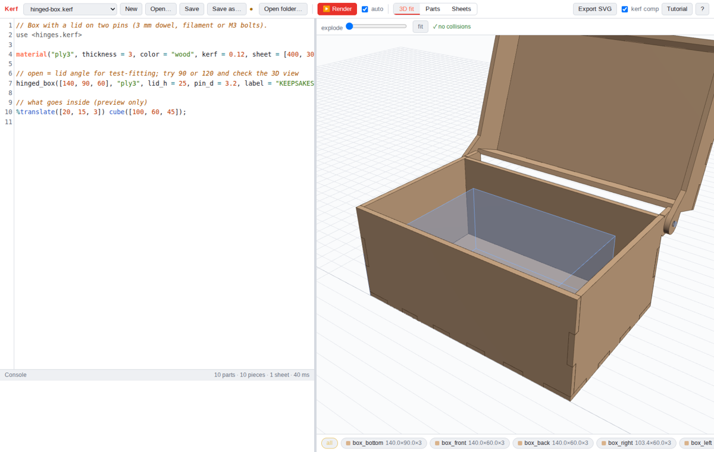
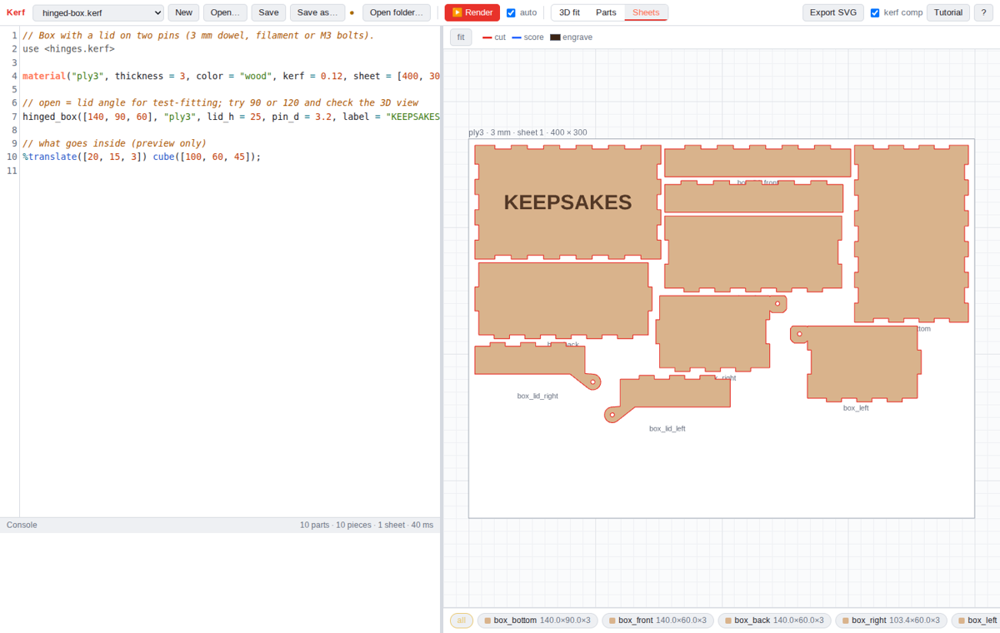
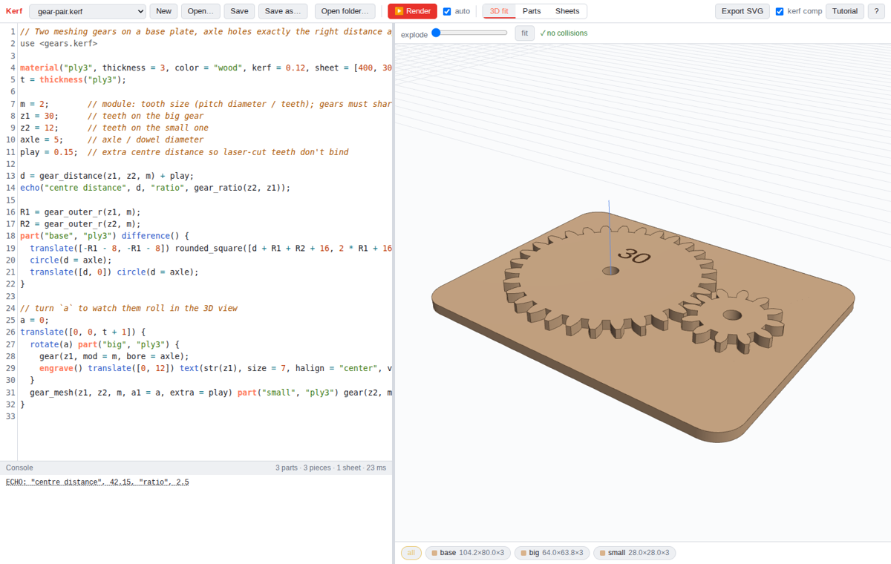

# Kerf

**Code CAD for laser cutting.** Kerf is like OpenSCAD, but built around flat parts. You write parts as 2D shapes
and booleans, give them a material and thickness, check the assembly in 3D, and export laid-out sheets as SVG,
with cut, score and engrave in separate colours.



**Try it:** https://kerf.bposhaughnessy.com, which runs entirely in your browser. There's also a [desktop app](#desktop-app)
and a [local mode](#local-mode).

## Why

Laser projects usually mean drawing in Inkscape, nudging finger joints by hand, and redoing it all when the
material turns out to be 3.2 mm instead of 3. In Kerf the design is a program. Change `t` and every joint, slot and
tab follows. Kerf then checks that the parts actually fit together before you burn any plywood.

## Features

- **OpenSCAD syntax.** Variables, modules, functions, `for`, `if`, list comprehensions, `include <>` / `use <>`, and
  the `# % * !` modifiers. If you know OpenSCAD you can start right away.
- **2D shapes and booleans.** `square`, `circle`, `polygon`, `text` (any font), `import("logo.svg")`, `offset`,
  `hull`, `minkowski`, `union`/`difference`/`intersection`.
- **Materials and parts.** `material("ply3", thickness = 3, kerf = 0.12, sheet = [400, 300])`. A `part()` is one
  piece cut from one material.
- **Laser operations.** `engrave()` fills areas (text, logos and bitmap `image()`s), `score()` draws lines without
  cutting through, and `cut()` cuts open lines.
- **3D fit check.** Parts are placed with ordinary 3D transforms. Kerf tests every pair of parts for overlap, and
  also tests them against `%cube` reference objects (the thing that goes in the box). It shows ✓ *no collisions*,
  or marks each collision in red. There's an explode slider too.
- **Sheet layout.** Parts are packed onto sheets of each material, with quantities, spacing and margins.
- **SVG export, one file per sheet, in mm.** Red stroke = cut, blue = score, black fill = engrave. Holes are
  written before outlines. Kerf compensation is optional and applied per material.
- **Built-in tutorial.** Thirteen lessons, from first shapes through a kerf-and-fit test card to boxes, hinges and gears. A language reference is on
  **F1**.



## A taste

```openscad
material("ply3", thickness = 3, kerf = 0.12, sheet = [400, 300]);
t = thickness("ply3");

part("lid", "ply3") {
  difference() {
    rounded_square([120, 80], r = 5);
    translate([60, 70]) slot(30, 8);                  // finger grip
  }
  engrave() translate([60, 35]) text("TOOLS", size = 14, halign = "center");
}

translate([0, 0, 60]) part("shelf", "ply3") square([120, 80]);   // place a part in 3D
%translate([10, 10, t]) cube([100, 60, 40]);                     // reference object, never cut
```

## Libraries

The standard library loads automatically. It has `rounded_square`, `ngon`, `slot`, finger joints
(`finger_tabs`, `finger_slots`), captive-nut T-slots, `living_hinge`, `hole_grid`, and `face_x`/`face_y` for
standing parts up. Three more libraries ship with Kerf. `use` any of them by name; a file in your own project
with the same name takes precedence.

**`use <boxes.kerf>`: finger-jointed boxes**

```openscad
finger_box([120, 80, 60], "ply3");                        // open box, all five parts placed in 3D
finger_box([120, 80, 60], "ply3", top = "lid", label = "SCREWS");   // with a lift-off lid
finger_box([100, 60, 40], "ply3", inside = true);         // size is the inside
```

To add holes or engraving to one panel, build the box from its pieces with `box_panel()` and `box_place()`, or
use `fj_panel()` for any finger-jointed panel at all.

**`use <hinges.kerf>`: a box with a pinned lid**

```openscad
hinged_box([140, 90, 60], "ply3", lid_h = 25, pin_d = 3.2, label = "KEEPSAKES", open = 110);
```

The lid pivots on two pins (dowel, filament or M3 bolts) through ears behind the box. The pivot sits so the lid
can swing past 90° without hitting the back. `open` rotates the lid in the 3D view so you can test the swing.
`bend_length(angle, r, t)` gives the length a living hinge needs for a bend.

**`use <gears.kerf>`: involute spur gears**

```openscad
d = gear_distance(30, 12, mod = 2);                       // centre distance: 42 mm
gear(30, mod = 2, bore = 5);
gear_mesh(30, 12, mod = 2) gear(12, mod = 2, bore = 5);   // placed at d, rotated so the teeth interleave
```

There are also `gear_pitch_r`, `gear_outer_r`, `gear_ratio`, `gear_mesh_angle` (to keep a pair meshed as you turn
one), `rack` and `on_rack`. For laser-cut gears, add 0.1–0.2 mm to the centre distance; `gear_mesh(..., extra = 0.15)`
does that for you.



## Using it with the laser

Kerf's export is built for software that assigns settings by colour, such as xTool Creative Space. Import the SVG
and give each colour its own power, speed and passes:

| Colour | Meaning |
|---|---|
| red stroke | cut through |
| blue stroke | score (line engrave) |
| black fill | fill engrave |
| embedded bitmap | image engrave |

Set `kerf` per material, at the beam width you measure. Lesson 9 of the tutorial builds a test card for measuring
it. When **kerf comp** is on, export grows outlines and shrinks holes by half the kerf, so parts come out the size
you drew.

## Ways to run it

### Website

The website at https://kerf.bposhaughnessy.com works like a desktop program.
- **Open… (Ctrl+O)** loads a `.kerf` file. Select its images, SVGs and fonts in the same dialog, or drag them onto
  the page.
- **Save (Ctrl+S)** writes the file back in place in Chrome/Edge, or downloads it in Firefox. In Firefox, turn on
  *Settings → Downloads → Always ask you where to save files* to get a save dialog.
- Unsaved work survives a closed tab as a draft.
- Text uses a bundled set of open fonts.

The website counts page views with a self-hosted, cookie-free [GoatCounter](https://www.goatcounter.com).
No personal data is collected, and the counter only runs on kerf.bposhaughnessy.com: local mode, the desktop
app and copies hosted anywhere else don't count anything.

### Desktop app

```
./build_appimage.sh      # → desktop/release/Kerf-1.0.0-x86_64.AppImage
```

The desktop app is an Electron AppImage.
- It has a native File menu and Open/Save dialogs, and saves in place.
- It reads images straight from disk next to your design, and can use every font installed on the system.
- Exports go to `export/` next to the design.
- Examples and the tutorial are copied to `~/Kerf`.
- `Kerf.AppImage design.kerf` opens a file directly.

**Ubuntu 23.10+ and "--no-sandbox".** Ubuntu now lets a program create user namespaces only if an AppArmor
profile allows it, and Chromium's sandbox needs them. Programs installed as `.deb` or snap ship such a profile.
AppImages can't, because they run from a temporary mount, and Chromium's setuid fallback doesn't work there either.
That's why Electron AppImages crash unless they get `--no-sandbox`. Kerf retries without the sandbox
automatically. To give Kerf, and every other AppImage, a working sandbox instead, run once:

```
sudo desktop/appimage-sandbox.sh          # undo: sudo desktop/appimage-sandbox.sh --remove
```

It adds one AppArmor profile, in the same form Ubuntu uses for Chrome and VS Code. The profile lets programs
running from an AppImage mount use user namespaces.

### Local mode

```
./run.sh                 # project folder = ./projects (examples copied in on first run)
./run.sh ~/some/folder   # any folder of .kerf files + images/SVGs
```

Local mode needs only Python 3. It starts a small standard-library server (`serve.py`) on http://127.0.0.1:8790/
that reads and writes your project folder and finds system fonts with `fc-match`. Exports go to
`<project>/export/`.

### Hosting your own copy

`./build_web.sh` produces a static site in `dist/`. Put it on any web server; there's no backend.

## How it works

| | |
|---|---|
| `js/lang/parser.js` | OpenSCAD-subset lexer and parser |
| `js/lang/interp.js` | evaluator and built-in modules (shapes, transforms, booleans, `part`, `material`, `engrave`/`score`/`cut`) |
| `lib/*.kerf` | standard library and the boxes / hinges / gears libraries, written in Kerf |
| `js/geom/` | Clipper booleans, text (opentype.js), SVG import, MaxRects sheet layout, 3D interference check, SVG export |
| `js/view/` | three.js assembly view and canvas 2D part/sheet view |
| `js/storage.js` | where files live: local server, opened files (website), a picked folder, or the desktop app |
| `desktop/` | Electron shell for the AppImage |
| `serve.py` | local-mode server |

- A **part** is the union of its children, extruded from z = 0 to the material's thickness. 3D transforms on a
  part place it in the assembly; 2D transforms inside it shape it.
- **Fit check:** the overlap between parallel or perpendicular parts is computed exactly; other pairs are sampled.
  Touching faces don't count as collisions.

## Tests

```
npm install     # dev dependencies for tests (clipper-lib, opentype.js, puppeteer-core)
npm test        # language, geometry, joints, libraries (box fit, hinge swing, gear mesh), layout, export
```

The headless UI tests in `test/` (`smoke`, `ui`, `tutorial`, `files`, `hosted`, `desktop`) drive Chrome or the
AppImage and need `KERF_URL` or a built app; each file's header shows how to run it.

## Licence

- **The Kerf app** (everything outside the folders below) is under the [GNU AGPL v3](LICENSE) or later. You can use,
  change and share it. If you distribute a modified version, or run one as a website for others, you must offer
  its source under the same licence.
- **The libraries, examples and tutorial lessons** (`lib/`, `examples/`, `tutorial/`) are under the
  [MIT licence](LICENSE-MIT), so designs that `use` or `include` them, or start from them, are yours to license
  however you like.
- **Your own designs**, and the SVGs Kerf exports, belong to you. Neither licence applies to them.

## Credits

Kerf bundles three.js, CodeMirror 5, opentype.js and Clipper (see [vendor/LICENSES.md](vendor/LICENSES.md)), and
open-licensed fonts (Liberation, DejaVu, Comfortaa, Comic Neue, Lobster Two, Allerta Stencil; licences in
`fonts/`).
